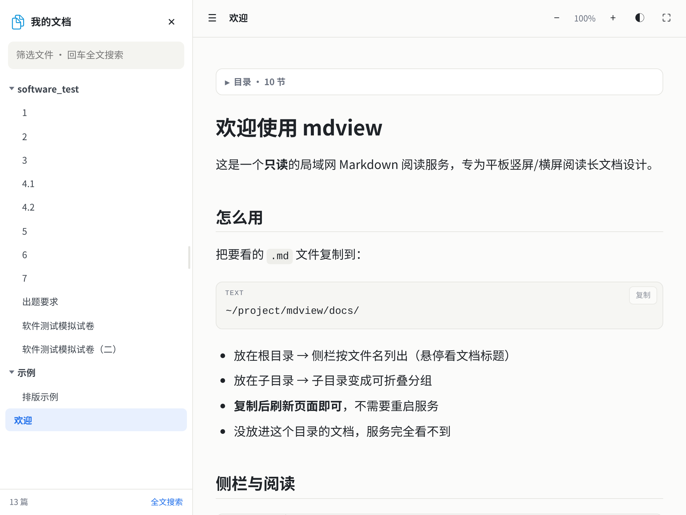

# mdview

面向平板的局域网 Markdown 与 PDF 阅读服务。电脑上启动服务，在同一网络的平板或手机上打开链接即可阅读。

- Markdown 服务端渲染，支持代码高亮、任务列表、表格、KaTeX 公式和 Mermaid 图表。
- PDF 使用浏览器阅读器打开，支持分段下载。
- 目录树支持筛选、排序、折叠和拖动调宽，可通过软链接共享外部目录。
- 切换文档不刷新页面，支持全屏、深色模式、阅读进度记忆、图片放大和代码复制。
- 正文缩放 60%–200%，支持双指捏合及独立调整正文宽度。
- 当前 Markdown 的文件变化通过每 4 秒一次的轮询检测，检测后自动更新正文并保留滚动位置。
- 前端资源随项目分发，Mermaid 按需加载，无需构建前端或访问 CDN。

## 安装与启动

使用 Python 3.12，通过虚拟环境安装依赖：

```bash
git clone https://github.com/adachissss/mdview.git ~/project/mdview
cd ~/project/mdview
python3 -m venv .venv
.venv/bin/python -m pip install -r requirements.txt
.venv/bin/python serve.py
```

服务默认监听 `0.0.0.0:8899`。终端会打印带访问令牌的链接：

```text
http://电脑IP:8899/?k=访问令牌
```

平板与电脑连接同一网络，首次打开完整链接后，浏览器会保存会话 Cookie，之后直接访问 `http://电脑IP:8899/` 即可。访问令牌保存在项目内的 `auth` 文件中，首次启动自动生成，权限为 `600`。修改文件中的 `用户名:口令` 后重启服务生效。

后台运行：

```bash
./mdview.sh start
./mdview.sh status
./mdview.sh log
./mdview.sh stop
./mdview.sh restart
```

脚本优先使用项目中的 `.venv/bin/python`，支持 `MDVIEW_PORT`、`MDVIEW_ROOT` 环境变量和启动参数：

```bash
MDVIEW_PORT=8900 ./mdview.sh start --bind 127.0.0.1
```

含空格的参数应直接传入脚本。`MDVIEW_ARGS` 可设置以空白分隔的简单附加参数。

## 放入文档

将文档和引用的图片一起放入 `docs/`，保持相对路径：

```text
docs/
├── 欢迎.md
└── 笔记/
    ├── 阅读.md
    ├── 参考.pdf
    └── assets/
        └── 示意图.png
```

子目录会显示为侧栏分组，支持 `.md`、`.markdown`、`.pdf`。隐藏文件、隐藏目录及 `node_modules` 等开发目录会被跳过。新增、删除、改名后刷新页面更新目录树；当前正在阅读的 Markdown 正文会自动更新。

不想复制文档时，可以在网页侧栏点击「＋ 目录」，选择电脑上的目录并创建共享链接，也可以执行：

```bash
ln -s ~/文档/笔记 docs/笔记
```

服务会跟随软链接，删除链接即可取消共享，原文件保持不变。仓库仅跟踪内置示例，个人文档、目录链接、口令和运行产物均由 `.gitignore` 排除。

## 界面预览




## 参数

| 参数 | 默认值 | 说明 |
|---|---|---|
| `--port` | `8899` | 监听端口 |
| `--bind` | `0.0.0.0` | 监听地址，仅本机使用时设为 `127.0.0.1` |
| `--root` | 项目内的 `docs/` | 文档根目录 |
| `--no-auth` | 关闭 | 免验证，允许能连接服务的人访问 |
| `--token` / `--password` | 从 `auth` 读取 | 本次启动的临时令牌，不写入文件 |
| `--basic` | 关闭 | 使用 HTTP Basic 账号密码验证 |
| `--verbose` | 关闭 | 输出访问日志 |

## 开机启动

按安装示例放在 `~/project/mdview` 并安装好虚拟环境后：

```bash
mkdir -p ~/.config/systemd/user
cp mdview.service ~/.config/systemd/user/
systemctl --user daemon-reload
systemctl --user enable --now mdview
loginctl enable-linger "$USER"
```

使用其他安装路径时，需要同步修改服务文件的 `WorkingDirectory` 和 `ExecStart`。启用 systemd 服务前先停止脚本启动的实例，避免端口冲突。

## 访问边界

- 适用于可信局域网，不适合直接暴露到公网；HTTP 本身不加密，跨网访问可使用 Tailscale 等私有网络。
- Markdown、PDF 和资源仅从配置的文档根目录读取，用户建立的软链接会扩展共享范围。
- 文档内容保持只读；「＋ 目录」接口只创建软链接，不修改或删除原文档。已获访问权限的用户也可以浏览电脑目录并添加共享目录。
- Markdown HTML 通过 `nh3` 清理，移除脚本、事件处理器和危险地址；文档中的 HTML 等附件以下载方式提供，图像资源带沙箱策略。
- 访问日志和 `auth` 含敏感信息，不应分享或提交。

## 项目结构与验证

```text
serve.py          HTTP 路由、鉴权、文件扫描与缓存
rendering.py      Markdown 渲染、HTML 清理与资源链接处理
static/           样式、交互和本地图表/公式资源
docs/             文档根目录与内置示例
tests/            服务端及浏览器回归测试
requirements.txt  Python 运行依赖
mdview.sh         后台启停脚本
mdview.service    systemd 用户服务
```

运行服务端回归和语法检查：

```bash
.venv/bin/python -m unittest discover -s tests -v
node --check static/app.js
bash -n mdview.sh
```

浏览器回归需要 Node.js 18+、系统 Google Chrome 和 Playwright（`npm install -g playwright`）：

```bash
node tests/browser.cjs
```

浏览器测试会启动独立的临时服务，检查公式、图表、文档切换与自动刷新，并在 `/tmp/mdview-review-*.png` 保存横竖屏截图。GitHub Actions 使用 Python 3.12 检查服务端测试和脚本语法。

## 常见问题

- **平板连接失败**：确认电脑端口在监听（`ss -lnt`），两台设备处于同一网络。校园网或公共 Wi-Fi 的客户端隔离会阻止互通，可使用电脑热点或家庭路由器。
- **图片不显示**：将图片目录与 Markdown 一起复制，保持原来的相对位置。
- **端口被占用**：先停止正在运行的实例，或使用 `--port 8900`。
- **导出排版后的 PDF**：浏览器选择「打印 → 保存为 PDF」，打印样式会隐藏侧栏和工具栏。
