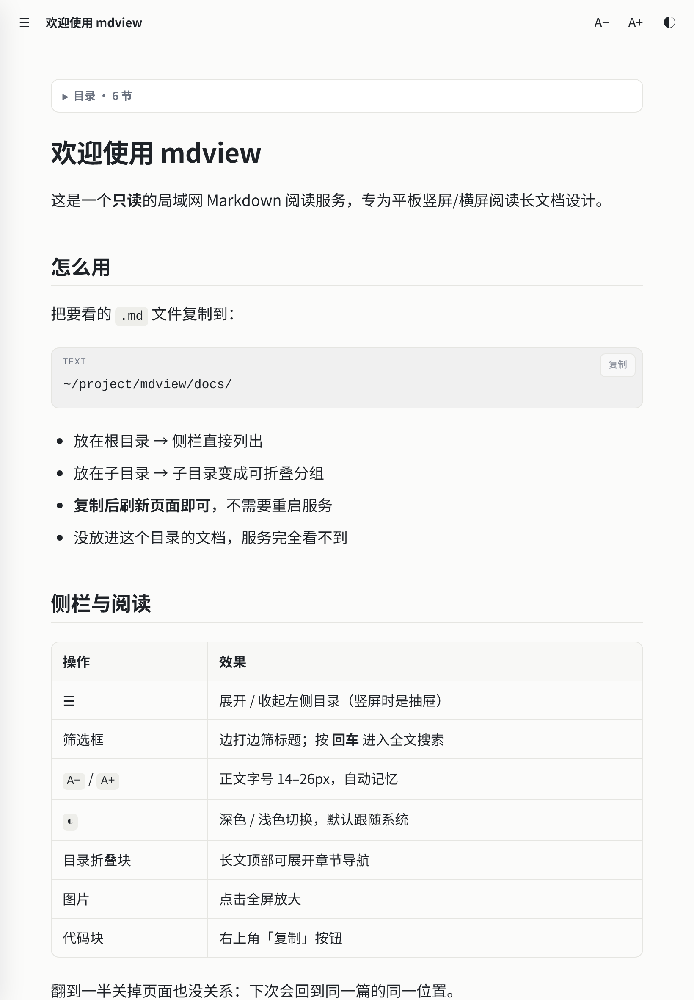
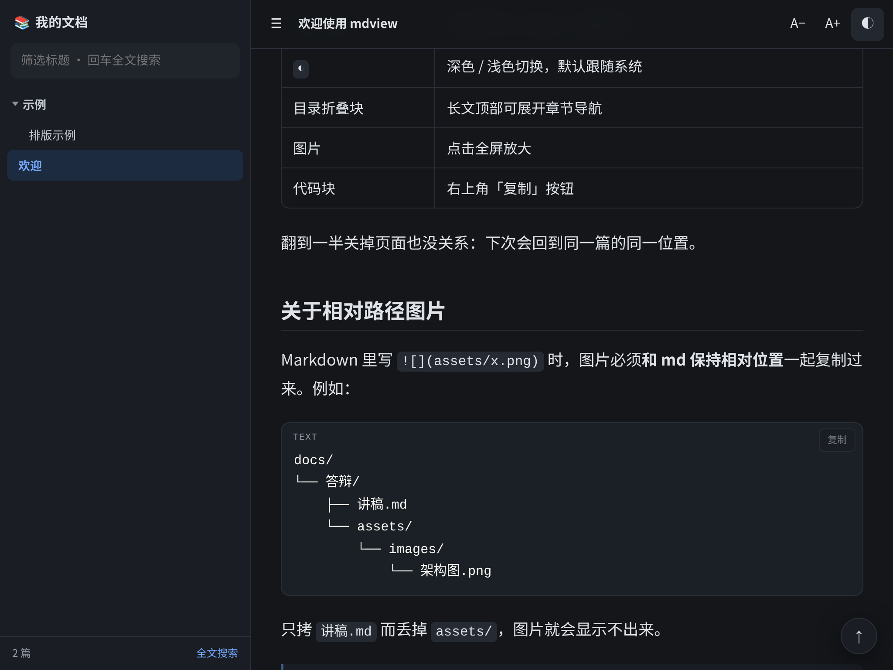

# mdview

局域网 Markdown 阅读服务：在平板上打开 `http://电脑IP:8899`，左侧目录树、右侧渲染正文。

- **Markdown + PDF**：`docs/` 里的 `.pdf` 也列进侧栏，点击用系统阅读器打开（支持 Range）
- **只开放一个目录**：只有 `docs/` 里的 `.md` / `.pdf` 会被看到，其它文档天然隔离；`docs/` 里用 `ln -s` 挂进来的外部目录也会被跟随
- **基本只读**：唯一的写操作是「＋ 目录」创建软链接（需令牌，路径与名字都校验）
- **单文件、零额外依赖**：只用 Python 标准库 + 已安装的 `markdown-it-py` / `pygments`
- **切换文档不刷新**：站内 AJAX 换正文，全屏下连续切文档不会被打断
- **改完自动生效**：正在看的 md 一改，4 秒内静默重渲染（不弹提示、保留滚动位置）
- **正文可拉宽**：拖动正文右边缘的把手调整栏宽（双击复位），与缩放互不干扰
- **为平板设计**：侧栏可完全收起（左缘留小把手点开）、可拖动调宽（220–460px，拖到最窄自动折叠）、正文缩放 60–200%（按钮或双指捏合）、全屏、深色模式、阅读进度记忆、图片灯箱、代码复制、KaTeX 公式、Mermaid 图表

## 快速开始

整个项目是自包含的：代码、文档、令牌、日志、截图全在 `~/project/mdview/` 里，
不会往 `~/.config`、`~/.local` 之类的地方写东西。

```
~/project/mdview/
├── serve.py          服务本体（单文件）
├── static/           样式与交互
├── docs/             唯一对外开放的文档目录 ← 你只需往这里放 md
├── auth              访问令牌（自动生成，别分享）
├── screenshots/      界面截图
├── mdview.sh         启停脚本
├── mdview.service    systemd 单元（可选）
├── mdview.log        运行日志
└── .mdview.pid       进程号
```

```bash
cd ~/project/mdview
python3 serve.py            # 前台运行，Ctrl+C 停止
```

终端会直接打印**带令牌的完整链接**，平板上打开就行，不弹账密框：

```
  访问令牌    xxxxxxxxx  (读取自 /home/adachi/project/mdview/auth)
  平板 / 手机（同一 Wi-Fi，复制整条）：
    http://10.69.249.5:8899/?k=xxxxxxxxx
```

第一次带 `?k=` 打开后，浏览器会种一个长期 cookie 并跳回干净地址，
之后直接输 `http://10.69.249.5:8899` 也能看，不用再输任何东西。

后台常驻：

```bash
./mdview.sh start     # 启动
./mdview.sh status    # 状态 + 可用地址
./mdview.sh log       # 看日志（含令牌）
./mdview.sh stop
```

开机自启（systemd 用户服务）：

```bash
mkdir -p ~/.config/systemd/user
cp mdview.service ~/.config/systemd/user/
systemctl --user daemon-reload
systemctl --user enable --now mdview
# 让服务在你退出登录后也继续跑
loginctl enable-linger "$USER"
```

## 界面预览

平板横屏（1024×768）：


平板竖屏（820×1180）：



深色模式：



## 放文档

```bash
cp ~/文档/MailNest-软件项目管理答辩/讲稿.md ~/project/mdview/docs/
cp -r ~/文档/MailNest-软件项目管理答辩/assets ~/project/mdview/docs/   # 有图片就连 assets 一起
```

- 子目录 = 侧栏分组，自动递归
- 新增/修改后**刷新页面**即可，无需重启
- 自动跳过 `node_modules`、`.git`、隐藏目录

## 参数

| 参数 | 默认 | 说明 |
|---|---|---|
| `--port` | `8899` | 监听端口 |
| `--bind` | `0.0.0.0` | 监听地址；只想本机用可设 `127.0.0.1` |
| `--root` | `./docs` | 文档根目录，可指向任意绝对路径 |
| `--no-auth` | 关 | 局域网免密 |
| `--token` | — | 本次启动临时令牌，不写入文件（`--password` 同义） |
| `--basic` | 关 | 改用 HTTP Basic 账密弹窗，而不是 URL 令牌 |
| `--verbose` | 关 | 打印访问日志 |

令牌就是项目里的 `auth`（权限 600）最后一行冒号后面的那串，改完重启生效。
整个目录可以直接打包搬走，换台机器解压就能跑。

## 平板访问

1. 平板和电脑连**同一个 Wi-Fi**
2. 浏览器打开 `http://电脑IP:8899`（iPad 也可用 `http://yuriyuri.local:8899`）
3. 第一次用带 `?k=` 的链接打开，浏览器记住后就不用了
4. Safari 可「添加到主屏幕」，用起来像 App

### 打不开？多半是 AP 隔离

校园网 / 公共 Wi-Fi 常开「客户端隔离」，同一 SSID 下设备也互相不通。判断：

```bash
# 电脑上先确认端口在监听
ss -lnt | grep 8899
# 记下电脑 IP
ip -4 addr show scope global
```

平板上访问不通时，按顺序试：

1. **电脑开热点**（最稳）
   ```bash
   nmcli device wifi hotspot ssid mdview password 12345678
   # 平板连 mdview，访问 http://10.42.0.1:8899
   nmcli connection down Hotspot   # 用完关掉
   ```
2. 换到家里路由器的同一个 LAN
3. 跨网访问用 Tailscale / ZeroTier，平板装客户端后用 `100.x` 地址

## 安全说明

- 这是**局域网**工具，不要直接暴露到公网
- 支持软链接：扫描时跟随 `docs/` 里的 `ln -s`（按 inode 去重防环），链接目标同样只读暴露，删链接即撤销
- 默认用 URL 令牌：没有 `?k=` 且没有 cookie 的请求只会看到拦截页，不弹账密框
- 校园网段（你这里是 `10.69.0.0/16`）里别人扫到端口也进不来，除非拿到令牌
- 需要更严格：`--bind` 绑到具体网卡地址，或用 `ufw` 限制来源
- 服务端不执行任何用户输入，文档里的 `<script>`、`on*=` 事件属性会被剥离

## 常见问题

**图片不显示**：只复制了 `.md`，没带图片目录。把 `assets/` 按原相对路径一起复制。

**改了 md 页面没变**：刷新（服务端按 mtime 失效缓存，正常刷新即可）。

**端口被占用**：`--port 8900`，或 `ss -lntp | grep 8899` 看是谁。

**中文文件名乱码**：服务端统一用 UTF-8，浏览器地址栏出现 `%E4%B8%AD` 是正常的。

**想看渲染后的 PDF**：iPad Safari 分享 → 打印 → 存储为 PDF，`@media print` 已隐藏侧栏和顶栏。
